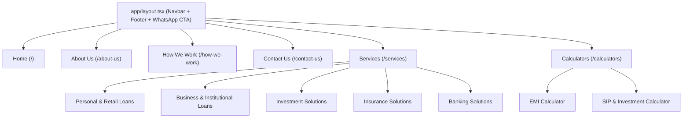

# Migration & Architecture Plan: Porting The Finance Suite to Next.js (React)

## 1. Overview & Objectives

**Target Site:** [thefinancesuite.com](https://thefinancesuite.com)  
**Target Directory:** `/Users/gauravkhare/Softwares/tfs`  
**Core Stack:** Next.js (App Router), TypeScript, Tailwind CSS, shadcn/ui, Lucide Icons, Zod + React Hook Form, Framer Motion.

### Key Goals:
- **Performance & SEO:** Sub-second page loads, SSG/ISR caching, and full Schema.org (`FinancialService`, `BreadcrumbList`) metadata.
- **Lead Conversion & Trust:** Sleek modern UI, sticky inquiry buttons, WhatsApp CTA, and validated lead capture forms.
- **Interactive Tools:** Dynamic financial calculators (Home/Personal Loan EMI, SIP returns, Business Loan eligibility).
- **Clean Code Organization:** Modular, domain-driven structure for easy maintenance and scaling.

---

## 2. Recommended Directory Organization (`tfs/`)

We will adopt the standard Next.js App Router layout with a feature-driven `components/` and `lib/` structure:

```
tfs/
├── app/                                 # Next.js App Router (Routing & Pages)
│   ├── layout.tsx                       # Root layout (Navbar, Footer, Global Providers)
│   ├── page.tsx                         # Landing Page (Hero, Trust metrics, Service grid, Testimonials)
│   ├── about-us/
│   │   └── page.tsx                     # Leadership (Prabhakar Khare), 37+ yrs banking legacy, Vision
│   ├── how-we-work/
│   │   └── page.tsx                     # 4-step consultation, approval, and disbursement flow
│   ├── services/
│   │   ├── page.tsx                     # Services Hub / Overview
│   │   ├── personal-retail-loans/       # Home, Car, Personal, Education loans
│   │   │   └── page.tsx
│   │   ├── business-institutional-loans/# Working capital, Machinery, SME & Agricultural loans
│   │   │   └── page.tsx
│   │   ├── investment-solutions/        # Mutual Funds, Equities, FDs, PMS, Bonds
│   │   │   └── page.tsx
│   │   ├── insurance-solutions/         # Life, Health, Motor, General insurance
│   │   │   └── page.tsx
│   │   └── banking-solutions/           # Savings/Current, NRI/NRE/NRO/FCNR accounts
│   │       └── page.tsx
│   ├── calculators/                     # Financial Calculator Hub
│   │   ├── page.tsx
│   │   ├── emi/page.tsx                 # Loan EMI Calculator
│   │   └── sip/page.tsx                 # Mutual Fund / SIP Returns Calculator
│   ├── contact-us/
│   │   └── page.tsx                     # Contact info, map, inquiry submission form
│   ├── privacy-policy/page.tsx
│   ├── terms-and-conditions/page.tsx
│   ├── sitemap.ts                       # Dynamic XML sitemap generator
│   ├── robots.ts                        # SEO robots.txt generator
│   └── api/
│       └── lead/route.ts                # Server API route / Server Action for lead handling
├── components/
│   ├── ui/                              # shadcn primitives (Button, Input, Slider, Dialog, Card)
│   ├── layout/                          # Header, NavigationMenu, MobileNav, Footer
│   ├── common/                          # TrustBadge, SectionHeading, WhatsAppButton, SchemaOrg
│   ├── home/                            # HeroSection, ServicesShowcase, WhyChooseUs, StatsCounter
│   ├── calculators/                     # EmiCalculator, SipCalculator, EligibilityCalculator
│   ├── services/                        # ServiceCard, FeatureList, DocumentChecklist, FaqAccordion
│   └── forms/                           # LeadCaptureModal, ContactForm, LoanInquiryForm
├── lib/
│   ├── config/                          # Site metadata, navigation links, company contact details
│   ├── content/                         # Static JSON/TS data extracted from current site
│   ├── calculators/                     # Pure financial calculation formulas (EMI, Compound Interest)
│   ├── validations/                     # Zod schemas for contact and loan forms
│   └── utils.ts                         # Tailwind clsx/twMerge helpers
├── public/
│   ├── images/                          # High-res logos, team photos, service banners
│   └── icons/
└── scripts/
    └── fetch-wp-content.ts              # Migration helper script to pull text/assets via WP REST API
```

---

## 3. Site Architecture & Page Breakdown



---

## 4. Financial Calculators Specification

Financial service platforms get significant recurring organic traffic from calculators:

1. **EMI Calculator (`components/calculators/EmiCalculator.tsx`)**:
   - Inputs: Loan Amount ($P$), Annual Interest Rate ($R$), Tenure in Months/Years ($N$).
   - Formula: $E = P \cdot r \cdot \frac{(1+r)^n}{(1+r)^n - 1}$
   - Interactive sliders + number inputs with dynamic visual breakdown (Principal vs. Total Interest chart).
   - "Apply for this Loan" CTA directly passing the calculated terms into the lead capture modal.

2. **SIP / Wealth Growth Calculator (`components/calculators/SipCalculator.tsx`)**:
   - Monthly investment amount, expected annual return rate, duration.
   - Computes total invested vs. estimated maturity returns.

---

## 5. Content Migration Strategy from Current WordPress Site

The live WordPress site at `thefinancesuite.com` already exposes the WordPress REST API:
- Endpoint: `https://thefinancesuite.com/wp-json/wp/v2/pages`

### Strategy:
1. **Extraction**:
   - Create a lightweight Node/TypeScript script (`scripts/fetch-wp-content.ts`) to scrape or fetch pages, post content, and image URLs.
   - Clean HTML tags and Gutenberg block markup into clean structured JSON/TypeScript dictionaries.
2. **Media Optimization**:
   - Download brand assets and team images to `public/images/`.
   - Serve using Next.js `next/image` with WebP/AVIF auto-compression.

---

## 6. Execution Phases

| Phase | Tasks | Deliverables |
|---|---|---|
| **Phase 1: Scaffolding & Setup** | Initialize Next.js project in `tfs/`, configure Tailwind CSS, install icons (`lucide-react`) and shadcn UI primitives. | Running skeleton app with theme & fonts |
| **Phase 2: Global Shell & Content Extraction** | Build responsive Navbar, Footer, WhatsApp floating CTA; pull text/assets from the current site. | Global layout, navigation, brand assets |
| **Phase 3: Core Landing & Static Pages** | Build Home, About Us, How We Work, Privacy, and Terms pages. | Fully styled high-conversion static pages |
| **Phase 4: Services Hub & Nested Routes** | Build 5 dedicated service pages (Retail Loans, Business Loans, Investments, Insurance, Banking). | Complete service catalog with document checklists and FAQs |
| **Phase 5: Financial Calculators & Lead Capture** | Build interactive EMI/SIP calculators, lead forms with validation, and email/WhatsApp dispatch. | Fully functioning conversion funnels |
| **Phase 6: SEO, Testing & Polish** | Add OpenGraph tags, JSON-LD Schema markup, mobile testing, and lighthouse optimization. | Production-ready Next.js web application |
